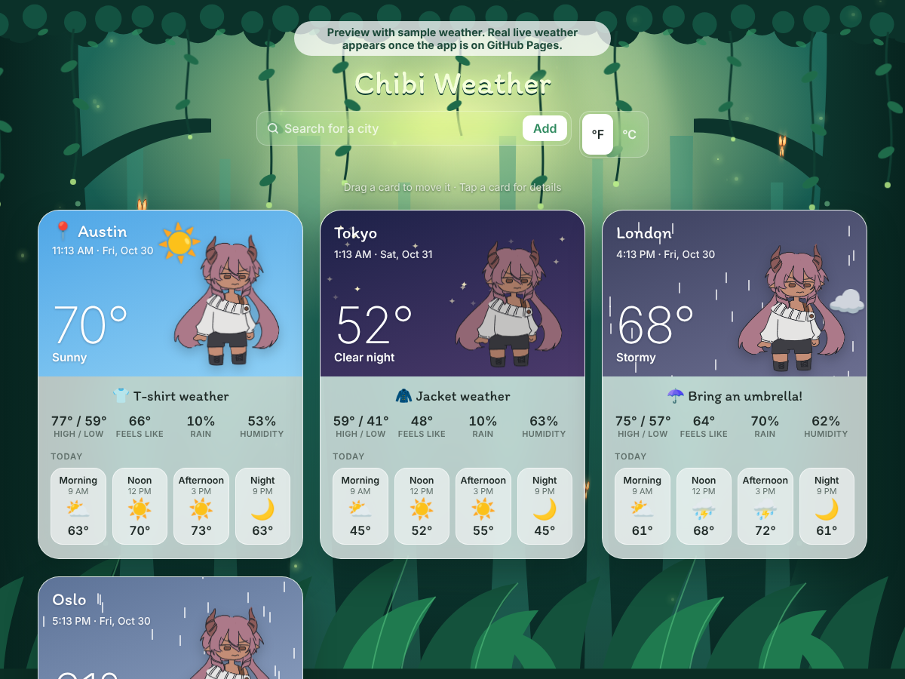

# 🌿 Chibi Weather

A cozy weather web app set in a magical forest. Each city gets its own card, and a chibi character reacts to the weather: she hops in the sun, shivers in the snow and stands in the rain under storm clouds.

**▶ Live app:** https://angie-n-soto.github.io/weather-app/

## Features
- 📍 **Your weather first:** the first card finds your city from your IP address, with no permission pop-up
- ➕ **Add any city** as its own card, Apple Weather-style. Your cities are remembered for next time
- ✋ **Drag cards** to reorder them (press and hold on phones)
- 🔎 **Tap a card for details:** the next 24 hours, feels-like, humidity, wind, UV index, sunrise and sunset
- 🌦️ **Animated skies** for sun, clouds, rain, snow, fog, night stars and thunderstorms with lightning
- 👕 **Outfit tips** based on the temperature
- 🌡️ **°F / °C switch**, and it works on phones and computers

## Built with
| | |
|---|---|
| **HTML** | Page structure (`index.html`) |
| **CSS** | Frosted-glass cards, the forest scene and the animations (`style.css`) |
| **JavaScript** | Calling the weather APIs, building the cards, drag-and-drop (`app.js`) |
| **[Open-Meteo](https://open-meteo.com/)** | Free weather forecast and city search APIs, with no API key needed |
| **[GeoJS](https://www.geojs.io/)** | Finds the visitor's approximate location from their IP |
| **GitHub Pages** | Free hosting |

No frameworks and no build step: just three files that any browser can run.

## How it works
1. **Find the visitor:** `get.geojs.io` returns the city and coordinates for the visitor's IP address.
2. **Get the weather:** `api.open-meteo.com/v1/forecast` returns the current, hourly and daily weather for those coordinates.
3. **Show it:** JavaScript turns each weather code (like `61` = rain) into words, an icon, a sky color and a mood for the character.

Each visitor's own browser asks for the weather directly, so the site has no server to overload.

## Run it on your computer
1. Download or clone this repo.
2. Open the folder in **VS Code** and install the **Live Server** extension.
3. Right-click `index.html` and choose **Open with Live Server**.

## Collaboration 🎨
Character art by **@yurienthu**. This project is a collaboration between a developer and a digital artist. [The art brief](docs/ART-BRIEF.md) is what I sent the artist, listing each weather pose, the icons and the file specs. The app is set up so new drawings drop right in (`CHIBI_ART` and `ICON_ART` in `app.js`).

## Project management
- [Project plan](docs/PLAN.md): milestones and progress checklist
- [Learning notes](docs/LEARN.md): notes on how HTML, CSS and JavaScript work together
- [10-day forecast plan](docs/TEN-DAY-FORECAST-GUIDE.md): my step-by-step plan for coding the next feature by hand

## Coming next
- [ ] 10-day forecast
- [ ] The artist's weather poses and drawn weather icons
- [ ] A full details page for each city

---
Made by Angie Soto · Art by @yurienthu · Weather data by [Open-Meteo](https://open-meteo.com/)
