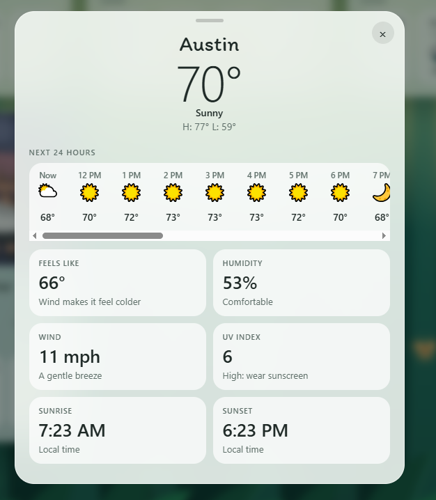
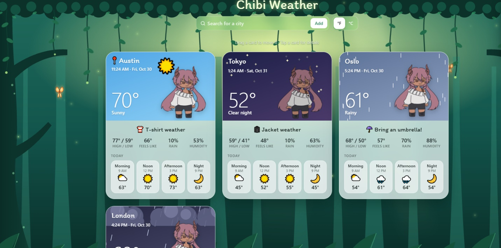

# Art for Chibi Weather

_The drawing request as sent to @yurienthu on Oct 30, 2026._

Helloo thanks so much for drawing for this. 💖 The app shows the weather, and your character reacts to it. Your current drawing already looks great in it!

## Your character in different weather

Same character, a different outfit or pose for each:

- **Sunny**: sunglasses or a sun hat
- **Cloudy**: your current drawing works for this one
- **Rainy**: holding an umbrella
- **Snowy**: scarf and mittens/jacket
- **Stormy**: hiding/large jacket and umbrella or scared
- **Foggy**: squinting or being mysterious
- **Night**: pajamas, sleepy

## Small weather icons

Simple little drawings: sun, moon, cloud, sun behind a cloud, rain, snow, lightning, fog

## A few things that help

- Please use a transparent background (like your current drawing).
- Draw the characters all about the same sizes
- Draw the icons on square canvases and keep them simple, because they show up small.

Send whatever you finish, in any order. File names don't matter.

## Extras

**Font:** If you'd like experimenting with the styles like if you find a font you prefer, send it to me and for the most part this is an easy change

**Background:** You can try drawing a background too that I can use as the back of the app, this may need layering so if you work in layers that may work best. Background should be big and wide (about 1920 × 1080 or larger), with the important parts in the middle, because phones crop the sides. Each layer would work best as its own transparent PNG (back trees, middle, front plants) so we can keep the movement.

**Colors:** If you would like to go a different direction in colors let me know and I can switch it up

**Animations:** If you wanna use toonsquid, you can try making the animations of the umbrellas or the characters cold and I can add that in as well. Try one at first and I can see what works or doesn't trying to add an animation lol (Should be PNG frames or transparent GIFS)

If you want to add any details like vines overlapping the cards or the buttons I can try doing that too, just make a similar drawing transparent and I can try clipping it shorter or elongating to see what works best to play around with the styles.

**Where to start, so it isn't overwhelming: If you only do a few, start with Sunny, Rainy and Night, plus the icons. No rush!**

**Credit:** Is @yurienthu okay for the credit, and should it link to your Tiktok portfolio?

Essentially, I also would like for your feedback and creative ideas on what you like or anything you would change on the app. I'm doing this to elarn too so open to any suggestions
